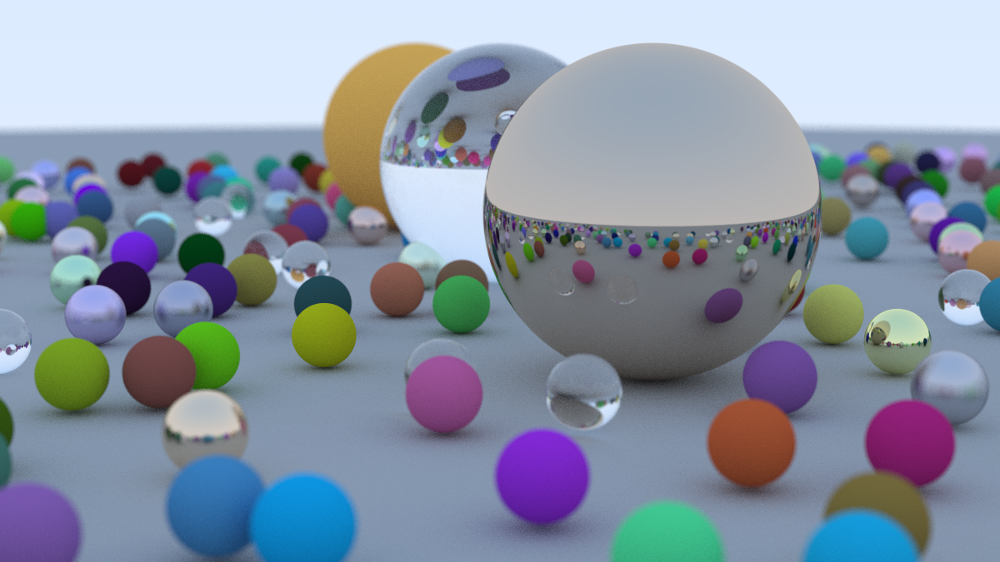
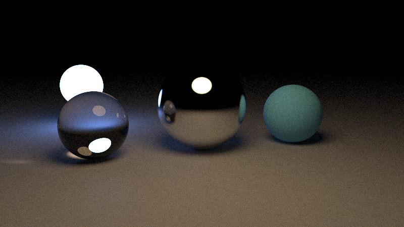
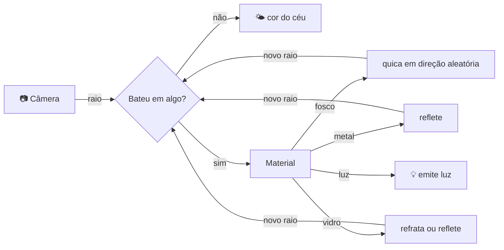

<h1 align="center">✨ Ray Tracer em C++</h1>

<p align="center">
  <a href="https://github.com/b4el/ray-tracer/actions/workflows/build.yml"></a>
  
  
  
  <a href="LICENSE"></a>
</p>

<p align="center">
  Um renderizador 3D <b>feito do zero</b>, sem nenhuma biblioteca gráfica: só C++ e matemática.<br>
  Simula como a luz quica pelo mundo para gerar imagens realistas, com reflexos, refração e sombras suaves.
</p>

<p align="center">
  
</p>

<p align="center">
  <a href="https://b4el.github.io/ray-tracer/"><b>🔍 Compare com a versão em tempo real (Three.js) no navegador</b></a>
</p>

<p align="center">
  
  
</p>

---

> **Está começando em C++?** Tem um [**tutorial passo a passo**](tutorial/README.md) que constrói um ray tracer do zero em 6 etapas, cada uma gerando uma imagem nova. Não precisa saber nada de computação gráfica.

## ✨ Funcionalidades

| | |
|---|---|
| 🎨 **Materiais** | Fosco (lambertiano), metal com rugosidade, vidro com refração (Snell + Schlick) e luzes |
| 📷 **Câmera** | Posição e alvo livres, campo de visão ajustável e **profundidade de campo** (desfoque de lente) |
| ⚡ **Multithread** | Divide as linhas da imagem entre todos os núcleos do processador com `std::thread` e `std::atomic` |
| 🌳 **BVH** | Árvore de caixas (Bounding Volume Hierarchy) que reduz o custo de cada raio de O(n) para ~O(log n) |
| 🖼️ **Saída** | BMP 24 bits (abre direto no Windows) ou PPM, escritos à mão byte a byte |
| 🌐 **Comparação web** | [Página interativa](https://b4el.github.io/ray-tracer/) que monta as mesmas cenas em Three.js (rasterização) lado a lado com o ray tracing, com modo de sobreposição |
| 🧪 **Testes** | Testes de vetores, interseção, BVH (comparada com força bruta) e formato BMP, rodando no CI |

## 🚀 Como rodar

**Pré-requisitos:** compilador C++17 (Visual Studio 2019+, GCC 8+ ou Clang 7+) e CMake 3.16+.

### Visual Studio

1. **Arquivo → Abrir → Pasta...** e escolha a pasta do projeto.
2. Na barra de cima, troque a configuração de **x64-Debug** para **x64-Release** (fica uns 10x mais rápido).
3. Ao lado do ▶, escolha **raytracer.exe** e pressione **Ctrl + F5**.
4. A imagem `imagem.bmp` aparece na pasta de build (`out/build/x64-Release`).

### Linha de comando

```bash
git clone https://github.com/b4el/ray-tracer.git
cd ray-tracer
cmake -S . -B build -DCMAKE_BUILD_TYPE=Release
cmake --build build --config Release

./build/raytracer --cena capa --largura 1200 --amostras 100 --saida capa.bmp
```

### Opções

| Opção | O que faz | Padrão |
|---|---|---|
| `--cena` | `capa`, `simples` ou `noite` | `capa` |
| `--saida` | arquivo `.bmp` ou `.ppm` | `imagem.bmp` |
| `--largura` | largura em pixels (a altura segue 16:9) | `800` |
| `--amostras` | raios por pixel: mais = menos ruído, mais lento | `50` |
| `--profundidade` | quantas vezes um raio pode quicar | `20` |
| `--threads` | `0` usa todos os núcleos | `0` |
| `--exportar` | salva as cenas em JSON (usado pela página web) e sai | — |

A capa acima (1200×675, 150 amostras) leva cerca de 1 minuto em 2 núcleos.

## 🧠 Como funciona

Para cada pixel, o programa dispara raios da câmera para dentro da cena e pergunta: *que luz chega por esse caminho?*



Cada quique absorve parte da luz (é aí que entram as cores). Repetindo isso dezenas de vezes por pixel e tirando a média, aparecem sozinhos sombras suaves, reflexos, cáusticas e a luz colorida que um objeto joga no outro.

## 📁 Estrutura

```
ray-tracer/
├── include/          # Cabeçalhos
│   ├── Vec3.h        # Vetor 3D, produto escalar/vetorial, reflexão e refração
│   ├── Objeto.h      # Interface abstrata de tudo que um raio pode atingir
│   ├── Esfera.h      # Interseção raio-esfera (equação do 2º grau)
│   ├── Cena.h        # Lista de objetos (padrão Composite)
│   ├── BVH.h         # Árvore de caixas para acelerar
│   ├── Caixa.h       # AABB e o teste das "fatias" (slab method)
│   ├── Material.h    # Difuso, Metal, Vidro e Luz (polimorfismo)
│   ├── Camera.h      # Câmera com foco e desfoque
│   └── ...
├── src/              # Implementações + main.cpp (linha de comando)
├── tests/            # Testes automatizados
├── tutorial/         # 6 etapas para iniciantes
└── docs/             # Página de comparação (Three.js), cenas.json e imagens
```

## 📚 O que este projeto pratica

- **Orientação a objetos:** classes abstratas, herança, `virtual`/`override` e polimorfismo
- **C++ moderno:** `std::shared_ptr`, lambdas, `constexpr`, `thread_local`, sobrecarga de operadores
- **Concorrência:** `std::thread`, `std::atomic` e `std::mutex`
- **Estruturas de dados:** árvore binária (BVH) construída recursivamente
- **Matemática aplicada:** álgebra linear, equações do 2º grau, Lei de Snell e amostragem de Monte Carlo
- **Engenharia:** CMake, testes automatizados e integração contínua no GitHub Actions
- **Web:** Three.js, WebGL e GitHub Pages, lendo as cenas exportadas pelo C++

## 🔭 Próximos passos

- [ ] Novos objetos: planos, triângulos e malhas `.obj`
- [ ] Texturas (xadrez, imagens)
- [ ] Salvar em PNG
- [ ] Ler a cena de um arquivo (o C++ já exporta; falta importar)
- [ ] Editor de cenas no navegador com Three.js
- [ ] Prévia em tempo real numa janela

## 📖 Referências

- [*Ray Tracing in One Weekend*](https://raytracing.github.io/), de Peter Shirley: a série gratuita que popularizou esse tipo de projeto.
- [*Physically Based Rendering*](https://pbr-book.org/): o livro de referência da área, para quem quiser ir longe.

## 📄 Licença

Distribuído sob a licença MIT. Veja [`LICENSE`](LICENSE).

---

<p align="center">Feito por <a href="https://github.com/b4el">Gabriel Leandro</a> 🤙</p>
