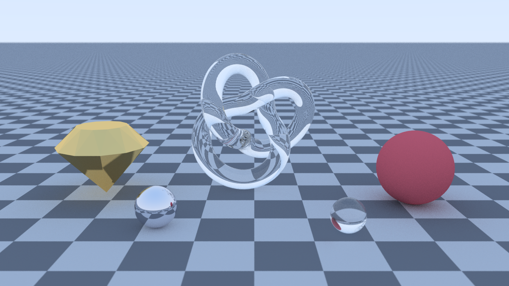
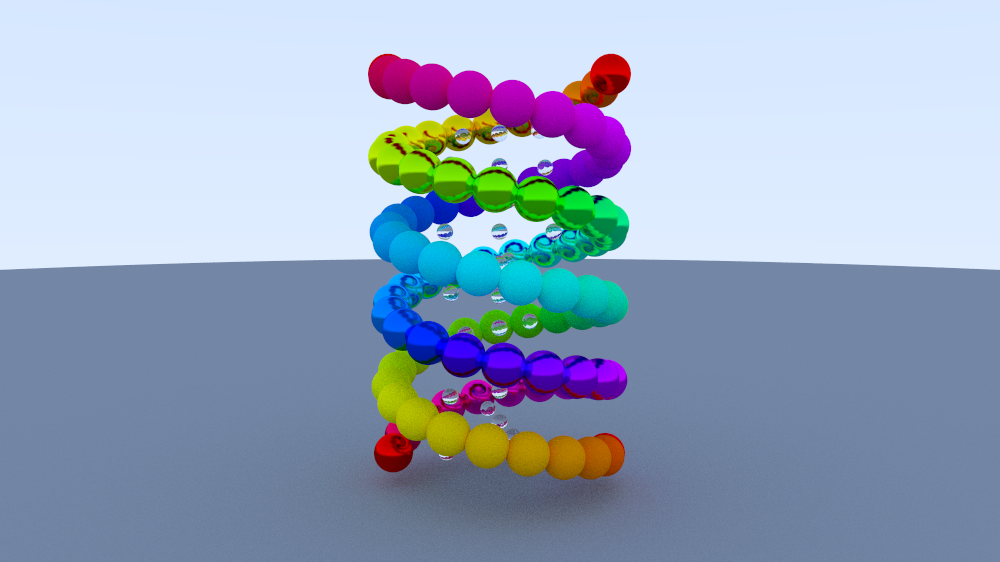
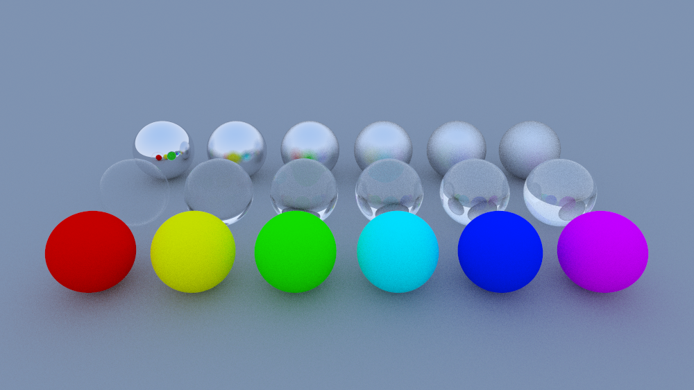
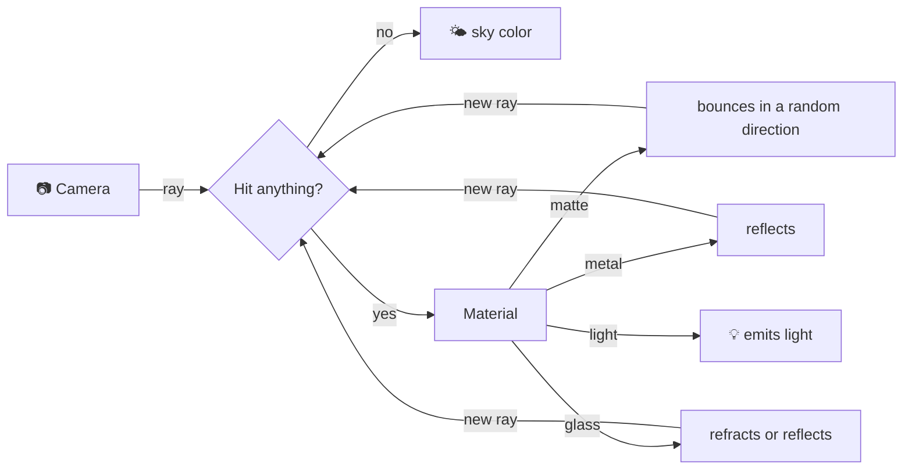

<h1 align="center">✨ Ray Tracer in C++</h1>

<p align="center">
  <a href="https://github.com/b4el/ray-tracer/actions/workflows/build.yml"></a>
  
  
  
  <a href="LICENSE"></a>
</p>

<p align="center">
  A 3D renderer <b>built from scratch</b>, with no graphics libraries: just C++ and math, plus scenes scripted in <b>Lua</b>.<br>
  It simulates how light bounces around a scene to produce realistic images, with reflections, refraction and soft shadows.
</p>

<p align="center">
  
</p>

<p align="center">
  <a href="https://b4el.github.io/ray-tracer/"><b>🔍 Compare it with a real-time version (Three.js) in your browser</b></a>
</p>

<p align="center">
  
  
  
</p>

---

> **New to C++?** There is a [**step-by-step tutorial**](tutorial/README.md) that builds a ray tracer from scratch in 6 stages, each one producing a new image. No computer graphics background needed.
>
> *Note: the source code, comments and tutorial are written in Brazilian Portuguese.*

## ✨ Features

| | |
|---|---|
| 🔺 **Triangles & 3D models** | Ray-triangle intersection (Möller–Trumbore), an `.obj` loader (polygons, negative indices, smooth vertex normals) and procedurally generated models |
| 🌙 **Lua scenes** | Scenes can be written as **Lua scripts** (loops, math, functions) and rendered without recompiling. Sandboxed, with line-accurate error messages |
| 🎨 **Materials** | Matte (Lambertian), metal with adjustable roughness, glass with refraction (Snell + Schlick) and light sources |
| 📷 **Camera** | Free position and target, adjustable field of view and **depth of field** (lens blur) |
| ⚡ **Multithreading** | Splits image rows across every CPU core using `std::thread` and `std::atomic` |
| 🌳 **BVH** | Bounding Volume Hierarchy that cuts the cost of each ray from O(n) to roughly O(log n) |
| 🖼️ **Output** | 24-bit BMP (opens natively on Windows) or PPM, written by hand byte by byte |
| 🌐 **Web comparison** | [Interactive page](https://b4el.github.io/ray-tracer/) that rebuilds the same scenes in Three.js (rasterization) next to the ray-traced result, with an overlay slider |
| 🧪 **Tests** | Tests for vectors, sphere and triangle intersections, the `.obj` parser, Lua scenes (including the sandbox), the BVH (checked against brute force) and the BMP format, running in CI |

## 🚀 Getting started

**Requirements:** a C++17 compiler (Visual Studio 2019+, GCC 8+ or Clang 7+), CMake 3.16+ and Git. Lua 5.4 is downloaded and built automatically by CMake the first time you configure the project.

### Visual Studio

1. **File → Open → Folder...** and pick the project folder.
2. In the toolbar, switch the configuration from **x64-Debug** to **x64-Release** (about 10× faster).
3. Next to the ▶ button, choose **raytracer.exe** and press **Ctrl + F5**.
4. The image `imagem.bmp` is saved in the build folder (`out/build/x64-Release`).

### Command line

```bash
git clone https://github.com/b4el/ray-tracer.git
cd ray-tracer
cmake -S . -B build -DCMAKE_BUILD_TYPE=Release
cmake --build build --config Release

./build/raytracer --cena capa --largura 1200 --amostras 100 --saida capa.bmp
```

### Options

The command-line flags are in Portuguese; here is what each one does:

| Flag | Meaning | Default |
|---|---|---|
| `--cena` | scene: `capa` (cover), `simples` (simple), `noite` (night), `modelos` (3D models) **or a Lua script** such as `cenas/espiral.lua` | `capa` |
| `--saida` | output file, `.bmp` or `.ppm` | `imagem.bmp` |
| `--largura` | image width in pixels (height follows 16:9) | `800` |
| `--amostras` | samples (rays) per pixel: more = less noise, slower | `50` |
| `--profundidade` | maximum number of bounces per ray | `20` |
| `--threads` | number of threads; `0` uses every core | `0` |
| `--exportar` | export the scenes as JSON (used by the web page) and exit | — |
| `--sem-bvh` | turn the BVH off, to measure how much it helps | off |

The cover image above (1200×675, 150 samples per pixel) takes about 1 minute on 2 cores.

## 🌙 Scenes in Lua

Besides the built-in scenes, any scene can be written as a **Lua script**. The C++ program embeds a Lua 5.4 interpreter, runs the script, and renders whatever it describes, so you can change a scene and render it again without recompiling. This is the same split many game engines use: C++ does the heavy lifting, a scripting language describes the content.

```lua
-- cenas/espiral.lua (simplified): a double helix built with a loop
-- (arcoIris is a small helper defined in the full file that turns 0..1 into a rainbow color)
esfera { centro = {0, -1000, 0}, raio = 1000, material = difuso {0.35, 0.37, 0.42} }

for i = 0, 47 do
  local t = i / 47
  local angulo = t * 2.5 * 2 * math.pi
  local a = { 1.2 * math.cos(angulo), 0.35 + t * 4.2, 1.2 * math.sin(angulo) }
  esfera { centro = a, raio = 0.22, material = difuso(arcoIris(t)) }
  esfera { centro = { -a[1], a[2], -a[3] }, raio = 0.22, material = metal(arcoIris(1 - t), 0.1) }
end

camera { posicao = {0, 3.2, 9}, alvo = {0, 2.3, 0}, campo_de_visao = 38 }
```

```bash
./build/raytracer --cena cenas/espiral.lua --saida espiral.bmp
```

<p align="center">
  
  
</p>
<p align="center"><sub><code>cenas/espiral.lua</code> · <code>cenas/materiais.lua</code> (metal roughness, glass refractive index and colors)</sub></p>

**The scene API** (names are in Portuguese, like the rest of the code):

| Function | What it does |
|---|---|
| `esfera { centro = {x, y, z}, raio = r, material = m }` | adds a sphere |
| `modelo { arquivo = "gema.obj", posicao = {x, y, z}, escala = s, material = m }` | adds a 3D model from `modelos/` |
| `camera { posicao = {...}, alvo = {...}, campo_de_visao = deg, abertura = a, distancia_foco = d }` | places the camera (all fields optional) |
| `ceu(true \| false)` | turns the sky light on or off |
| `difuso {r, g, b}`, `metal({r, g, b}, roughness)`, `vidro(index)`, `luz {r, g, b}` | materials (matte, metal, glass, light) |

**Safe by design:**

- Scripts run in a **sandbox**: only the `math`, `string`, `table` and `utf8` libraries are available. There is no `io`, `os`, `require`, `dofile` or `loadfile`, so a scene file cannot read your files or run commands.
- Only plain-text Lua is accepted (no precompiled bytecode).
- An **instruction limit** stops scripts stuck in an infinite loop.
- Errors point to the exact file and line: `cenas/minha.lua:12: esfera: falta o campo 'raio'`.

Start with [`cenas/exemplo.lua`](cenas/exemplo.lua): every line is commented.

## ⚡ Performance

Measured on a 2-core machine with `--threads` and `--sem-bvh` (Release build):

| Scene | Objects | Without BVH | With BVH | Speedup |
|---|---|---|---|---|
| `modelos` (320×180, 4 samples) | 9,600+ triangles + 4 spheres | 22.6 s | **0.15 s** | **~150×** |
| `capa` (400×225, 10 samples) | 485 spheres | 2.30 s | **0.50 s** | **~4.6×** |

| Threads (`capa`, with BVH) | Time | Speedup |
|---|---|---|
| 1 | 0.98 s | 1× |
| 2 | **0.50 s** | **~2×** (scales linearly with cores) |

Without a BVH, every ray is tested against every object, so the cost grows with the size of the scene. With it, a ray skips whole groups of objects whose bounding box it misses, which is why the gain is so much bigger for the 9,600-triangle model.

Try it yourself:

```bash
./build/raytracer --cena modelos --largura 320 --amostras 4
./build/raytracer --cena modelos --largura 320 --amostras 4 --sem-bvh
```

## 🧠 How it works

For every pixel, the program shoots rays from the camera into the scene and asks: *how much light arrives along this path?*



Each bounce absorbs part of the light, which is where colors come from. Repeat this dozens of times per pixel and average the results, and soft shadows, reflections, caustics and colored light spilling from one object onto another all emerge on their own.

## 📁 Project structure

```
ray-tracer/
├── include/          # Headers
│   ├── Vec3.h        # 3D vector: dot/cross products, reflection and refraction
│   ├── Objeto.h      # Abstract interface for anything a ray can hit
│   ├── Esfera.h      # Ray-sphere intersection (quadratic equation)
│   ├── Triangulo.h   # Ray-triangle intersection (Möller–Trumbore)
│   ├── Malha.h       # .obj loader
│   ├── ScriptLua.h   # Lua scene scripts (C++ ↔ Lua bridge, sandbox)
│   ├── Cena.h        # List of objects (Composite pattern)
│   ├── BVH.h         # Acceleration tree of bounding boxes
│   ├── Caixa.h       # AABB and the slab test
│   ├── Material.h    # Matte, Metal, Glass and Light (polymorphism)
│   ├── Camera.h      # Camera with focus and lens blur
│   └── ...
├── src/              # Implementations + main.cpp (command line)
├── cenas/            # Example scenes written in Lua
├── modelos/          # 3D models (.obj)
├── ferramentas/      # Python script that generates the models
├── tests/            # Automated tests
├── tutorial/         # 6-stage beginner tutorial
└── docs/             # Comparison page (Three.js), cenas.json and images
```

## 📚 What this project practices

- **Object-oriented design:** abstract classes, inheritance, `virtual`/`override` and polymorphism
- **Modern C++:** `std::shared_ptr`, lambdas, `constexpr`, `thread_local`, operator overloading
- **Concurrency:** `std::thread`, `std::atomic` and `std::mutex`
- **Data structures:** a binary tree (BVH) built recursively
- **Applied math:** linear algebra, quadratic equations, barycentric coordinates, Snell's law and Monte Carlo sampling
- **File parsing:** a tolerant `.obj` reader with clear error messages
- **Embedding a scripting language:** the Lua C API, a C/C++ boundary that is safe with `longjmp`-based errors, sandboxing and execution limits
- **Build tooling:** CMake `FetchContent` to download and build a C dependency
- **Engineering:** CMake, automated tests and continuous integration with GitHub Actions
- **Web:** Three.js, WebGL and GitHub Pages, reading scenes exported by the C++ program

## 🔭 Roadmap

- [x] Triangles and `.obj` meshes
- [ ] Planes and textures (checkerboard, images)
- [ ] PNG output
- [x] Scenes described in Lua scripts
- [ ] Lua scenes on the comparison page (show the script next to the image)
- [ ] In-browser scene editor with Three.js
- [ ] Real-time preview window
- [ ] Run the ray tracer in the browser with WebAssembly

## 📖 References

- [*Ray Tracing in One Weekend*](https://raytracing.github.io/) by Peter Shirley: the free book series that made this kind of project popular.
- [*Physically Based Rendering*](https://pbr-book.org/): the field's reference book, for going much further.

## 📄 License

Released under the MIT License. See [`LICENSE`](LICENSE).

---

<p align="center">Made by <a href="https://github.com/b4el">Gabriel Leandro</a> 🤙</p>
