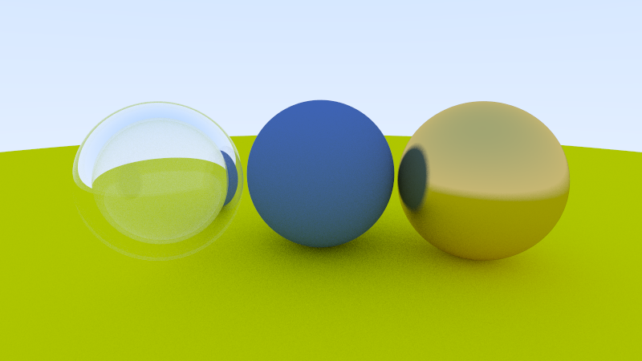
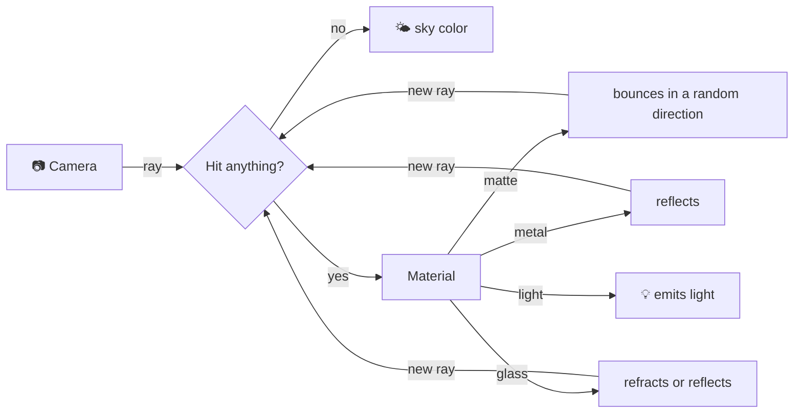

<h1 align="center">✨ Ray Tracer in C++</h1>

<p align="center">
  <a href="https://github.com/b4el/ray-tracer/actions/workflows/build.yml"></a>
  
  
  
  <a href="LICENSE"></a>
</p>

<p align="center">
  A 3D renderer <b>built from scratch</b>, with no graphics libraries: just C++ and math.<br>
  It simulates how light bounces around a scene to produce realistic images, with reflections, refraction and soft shadows.
</p>

<p align="center">
  
</p>

<p align="center">
  <a href="https://b4el.github.io/ray-tracer/"><b>🔍 Compare it with a real-time version (Three.js) in your browser</b></a>
</p>

<p align="center">
  
  
</p>

---

> **New to C++?** There is a [**step-by-step tutorial**](tutorial/README.md) that builds a ray tracer from scratch in 6 stages, each one producing a new image. No computer graphics background needed.
>
> *Note: the source code, comments and tutorial are written in Brazilian Portuguese.*

## ✨ Features

| | |
|---|---|
| 🎨 **Materials** | Matte (Lambertian), metal with adjustable roughness, glass with refraction (Snell + Schlick) and light sources |
| 📷 **Camera** | Free position and target, adjustable field of view and **depth of field** (lens blur) |
| ⚡ **Multithreading** | Splits image rows across every CPU core using `std::thread` and `std::atomic` |
| 🌳 **BVH** | Bounding Volume Hierarchy that cuts the cost of each ray from O(n) to roughly O(log n) |
| 🖼️ **Output** | 24-bit BMP (opens natively on Windows) or PPM, written by hand byte by byte |
| 🌐 **Web comparison** | [Interactive page](https://b4el.github.io/ray-tracer/) that rebuilds the same scenes in Three.js (rasterization) next to the ray-traced result, with an overlay slider |
| 🧪 **Tests** | Tests for vectors, intersections, the BVH (checked against brute force) and the BMP format, running in CI |

## 🚀 Getting started

**Requirements:** a C++17 compiler (Visual Studio 2019+, GCC 8+ or Clang 7+) and CMake 3.16+.

### Visual Studio

1. **File → Open → Folder...** and pick the project folder.
2. In the toolbar, switch the configuration from **x64-Debug** to **x64-Release** (about 10× faster).
3. Next to the ▶ button, choose **raytracer.exe** and press **Ctrl + F5**.
4. The image `imagem.bmp` is saved in the build folder (`out/build/x64-Release`).

### Command line

```bash
git clone https://github.com/b4el/ray-tracer.git
cd ray-tracer
cmake -S . -B build -DCMAKE_BUILD_TYPE=Release
cmake --build build --config Release

./build/raytracer --cena capa --largura 1200 --amostras 100 --saida capa.bmp
```

### Options

The command-line flags are in Portuguese; here is what each one does:

| Flag | Meaning | Default |
|---|---|---|
| `--cena` | scene: `capa` (cover), `simples` (simple) or `noite` (night) | `capa` |
| `--saida` | output file, `.bmp` or `.ppm` | `imagem.bmp` |
| `--largura` | image width in pixels (height follows 16:9) | `800` |
| `--amostras` | samples (rays) per pixel: more = less noise, slower | `50` |
| `--profundidade` | maximum number of bounces per ray | `20` |
| `--threads` | number of threads; `0` uses every core | `0` |
| `--exportar` | export the scenes as JSON (used by the web page) and exit | — |

The cover image above (1200×675, 150 samples per pixel) takes about 1 minute on 2 cores.

## 🧠 How it works

For every pixel, the program shoots rays from the camera into the scene and asks: *how much light arrives along this path?*



Each bounce absorbs part of the light, which is where colors come from. Repeat this dozens of times per pixel and average the results, and soft shadows, reflections, caustics and colored light spilling from one object onto another all emerge on their own.

## 📁 Project structure

```
ray-tracer/
├── include/          # Headers
│   ├── Vec3.h        # 3D vector: dot/cross products, reflection and refraction
│   ├── Objeto.h      # Abstract interface for anything a ray can hit
│   ├── Esfera.h      # Ray-sphere intersection (quadratic equation)
│   ├── Cena.h        # List of objects (Composite pattern)
│   ├── BVH.h         # Acceleration tree of bounding boxes
│   ├── Caixa.h       # AABB and the slab test
│   ├── Material.h    # Matte, Metal, Glass and Light (polymorphism)
│   ├── Camera.h      # Camera with focus and lens blur
│   └── ...
├── src/              # Implementations + main.cpp (command line)
├── tests/            # Automated tests
├── tutorial/         # 6-stage beginner tutorial
└── docs/             # Comparison page (Three.js), cenas.json and images
```

## 📚 What this project practices

- **Object-oriented design:** abstract classes, inheritance, `virtual`/`override` and polymorphism
- **Modern C++:** `std::shared_ptr`, lambdas, `constexpr`, `thread_local`, operator overloading
- **Concurrency:** `std::thread`, `std::atomic` and `std::mutex`
- **Data structures:** a binary tree (BVH) built recursively
- **Applied math:** linear algebra, quadratic equations, Snell's law and Monte Carlo sampling
- **Engineering:** CMake, automated tests and continuous integration with GitHub Actions
- **Web:** Three.js, WebGL and GitHub Pages, reading scenes exported by the C++ program

## 🔭 Roadmap

- [ ] New shapes: planes, triangles and `.obj` meshes
- [ ] Textures (checkerboard, images)
- [ ] PNG output
- [ ] Load scenes from a file (export already works; import is next)
- [ ] In-browser scene editor with Three.js
- [ ] Real-time preview window

## 📖 References

- [*Ray Tracing in One Weekend*](https://raytracing.github.io/) by Peter Shirley: the free book series that made this kind of project popular.
- [*Physically Based Rendering*](https://pbr-book.org/): the field's reference book, for going much further.

## 📄 License

Released under the MIT License. See [`LICENSE`](LICENSE).

---

<p align="center">Made by <a href="https://github.com/b4el">Gabriel Leandro</a> 🤙</p>
