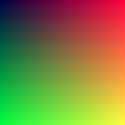
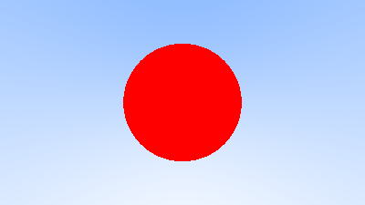
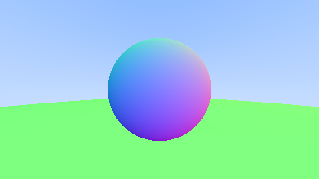
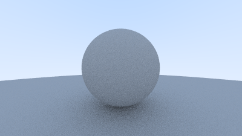
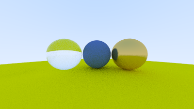

# 🎓 Tutorial: seu primeiro ray tracer em 6 etapas

Este tutorial é para quem **está começando em C++**. Se você já sabe `if`, `for`, funções e `struct`, consegue acompanhar. A matemática é explicada nos comentários do código, sem pressa.

Cada etapa é **um único arquivo `.cpp`**, que funciona sozinho e gera uma imagem. A etapa seguinte é a anterior com uma ideia nova, marcada com `// NOVO` no código.

| Etapa | O que você aprende | Resultado |
|---|---|---|
| [1. Primeira imagem](etapa1_primeira_imagem.cpp) | Pixels, cores RGB, laços aninhados |  |
| [2. Raios e céu](etapa2_raios_e_ceu.cpp) | `struct Vec3`, sobrecarga de operadores, o que é um raio |  |
| [3. Primeira esfera](etapa3_primeira_esfera.cpp) | Produto escalar, equação do 2º grau |  |
| [4. Normais e cena](etapa4_normais_e_cena.cpp) | Normal da superfície, `vector` de objetos, achar o mais próximo |  |
| [5. Luz difusa](etapa5_luz_difusa.cpp) | Números aleatórios, **recursão**, antialiasing, correção gama |  |
| [6. Materiais](etapa6_materiais.cpp) | **Herança e polimorfismo**, `shared_ptr`, reflexão e refração |  |

## Como rodar uma etapa

### Opção 1: Visual Studio, projeto do zero (mais simples)

1. Crie um novo **Aplicativo de Console** em C++.
2. Copie o conteúdo da etapa para o arquivo `.cpp` que o Visual Studio criou.
3. Copie o arquivo [`bmp.h`](bmp.h) para a mesma pasta do `.cpp` (botão direito no projeto → **Adicionar → Item Existente**).
4. Troque **Debug** por **Release** na barra de cima e rode com **Ctrl + F5**.
5. A imagem (`etapa1.bmp`, `etapa2.bmp`...) aparece na pasta do projeto. Abra com o visualizador de fotos do Windows.

### Opção 2: junto com o projeto todo

Abra a pasta do repositório no Visual Studio (**Arquivo → Abrir → Pasta**). Cada etapa já aparece como um programa separado (`etapa1_primeira_imagem.exe` etc.) no seletor ao lado do ▶.

## Dicas para estudar

- **Rode antes de ler.** Veja a imagem e depois entenda o código que a gerou.
- **Mude números e veja o que acontece.** Raio da esfera, posição, cores. Quebrar as coisas é o melhor jeito de aprender.
- **Faça os desafios** do final de cada arquivo antes de passar para a próxima etapa.
- **Compare as etapas** lado a lado: procure por `// NOVO` para ver só o que mudou.
- Travou na matemática? Tudo bem: dá para seguir em frente entendendo *o que* a função faz, e voltar no *como* depois.

## E depois da etapa 6?

O projeto principal (pastas [`include/`](../include) e [`src/`](../src)) é a versão "profissional" do que você construiu, organizada em vários arquivos e com:

- câmera que pode ser movida e apontada, com desfoque de lente;
- materiais que emitem luz;
- **várias threads** para usar todos os núcleos do processador;
- uma **BVH**, a estrutura de dados que deixa centenas de objetos rápidos.

Tente ler o código principal comparando com o que você fez nas etapas: os nomes são os mesmos.
